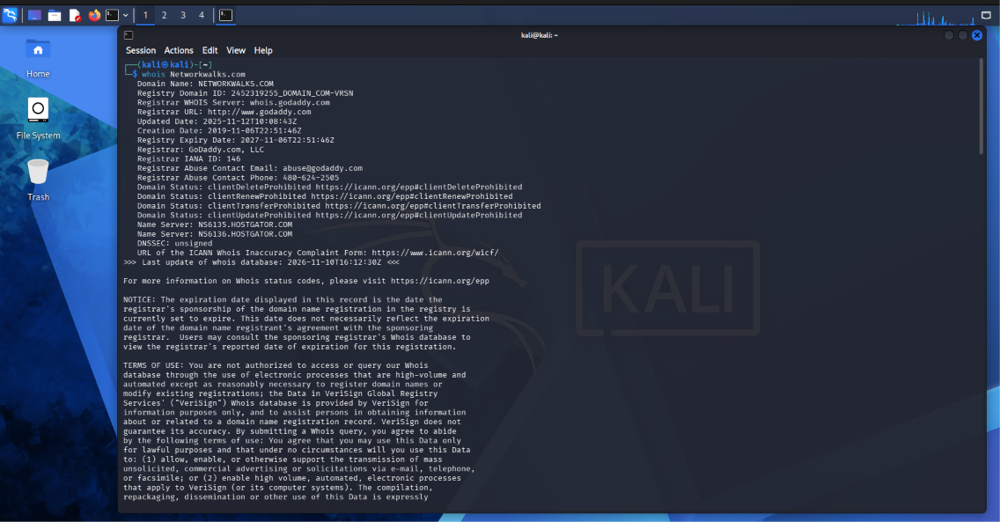
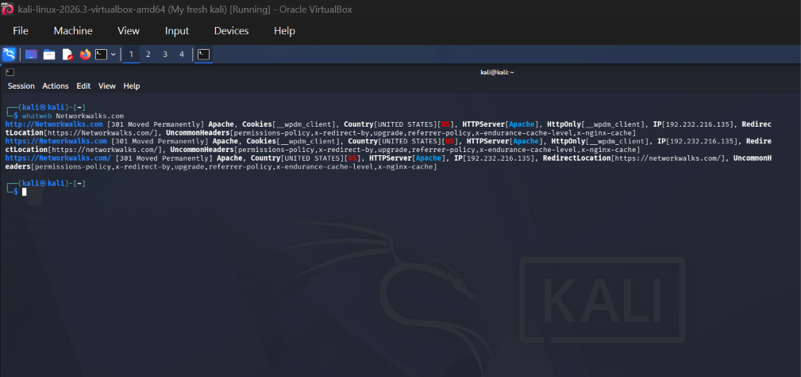
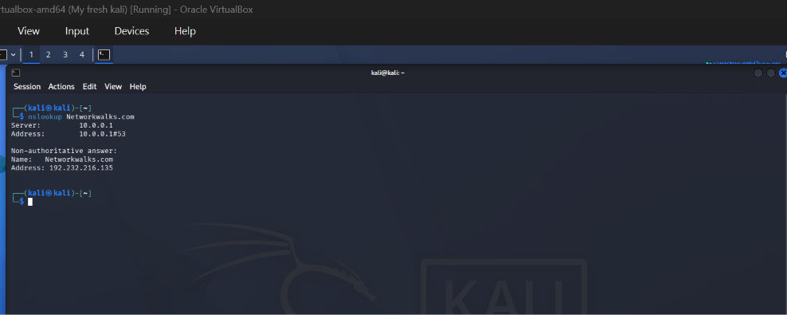
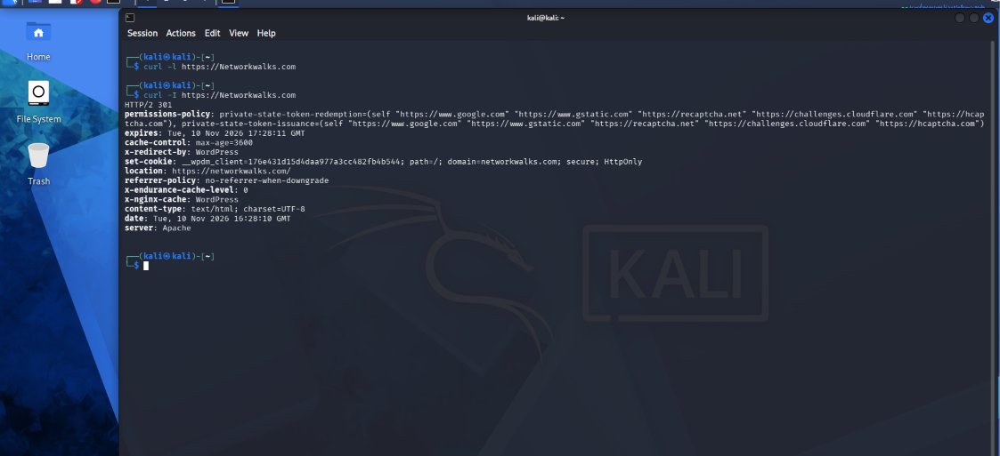
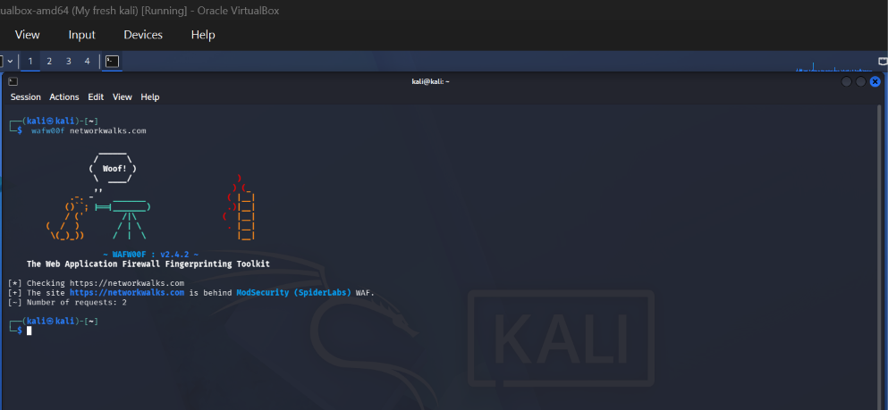
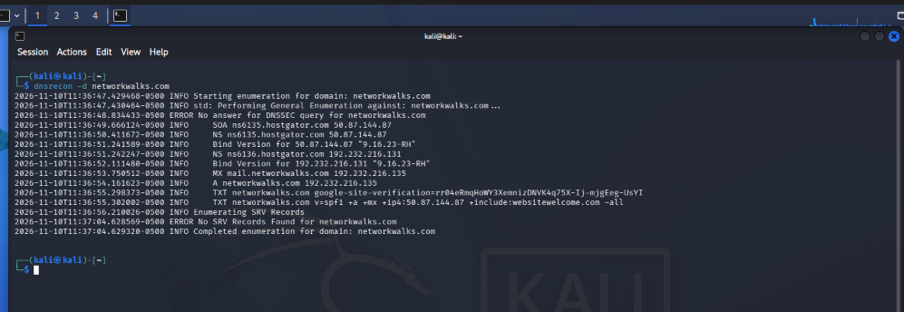
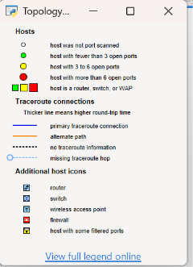

# NETWORKWALKS-B084-WEEK1-CYBERSECURITY-LAB-SETUP
 ## Project Overview (Week 1 | Project Module 1)
This repository contains the documentation and proof of execution for setting up a baseline Cybersecurity testing lab environment. The lab consists of a host machine running VirtualBox and a Kali Linux virtual machine configured for penetration testing tasks.

##  Lab Requirements Achieved
- **Hypervisor:** VirtualBox (Latest Version)
- **Attacker Machine:** Kali Linux (Latest Version, VM)
- **Network Configuration:** NATNetwork configured with `10.0.0.0/24` subnet
- **VM Settings:** Bidirectional Clipboard & File drag/drop enabled
- **Shared Folders:** `/downloads` folder successfully shared from the host machine to the VM
- **IP Configuration:** Kali Linux assigned the IP Address `10.0.0.2/24`
- **Connectivity:** Verified that Kali Linux has full Internet access

## 📸 Proof of Concept (Screenshots)

Below are the screenshots verifying the successful configuration of the lab environment:

### 1. Kali Linux virtual machine
[Kali linux](kaliVM.png)

### 2. VirtualBox NAT Network Configuration
[NAT Network](NAT.png)

### 3. Kali Linux IP Address (`10.0.0.2`)
[Kali IP Address](ipconfig.png)

### 4. Internet Access
[Internet Access such as ping](ping.png)

### 4.Snapshot of VM
[snapshot](snapshotVM.png)
-----------------------------------------------------------------------------------------------------------------------------

# Networkwalks Cybersecurity Internship - Week 2 Practical Labs

## 📌 Overview
This repository contains the lab documentation, execution commands, and task summaries for **Week 2** of the **Networkwalks Cybersecurity Internship Program**.

---

## 🛠️ Practical Module 1: Reconnaissance & Information Gathering

### Task 1: Domain Registration Details (`whois`)
* **Command:** `whois networkwalks.com`
* **Description:** Retrieved domain registration details, owner info, registrar data, creation/expiry dates, and authoritative name servers.
* 

### Task 2: Web Technology Fingerprinting (`whatweb`)
* **Command:** `whatweb networkwalks.com`
* **Description:** Identified web application tech stacks, server software, CMS details, embedded scripts, and HTTP status codes.
* 

### Task 3: DNS Resolution (`nslookup`)
* **Command:** `nslookup networkwalks.com`
* **Description:** Queried DNS servers to resolve hostnames to their respective IP address mappings.
* 

### Task 4: HTTP Response Headers Inspection (`curl -I`)
* **Command:** `curl -I https://networkwalks.com`
* **Description:** Inspected HTTP response headers to analyze web server configurations and missing security headers.
* 

### Task 5: Web Application Firewall Detection (`wafw00f`)
* **Command:** `wafw00f networkwalks.com`
* **Description:** Fingerprinted target behavior to detect and identify active Web Application Firewalls (WAF).
* 

### Task 6: DNS Record Enumeration (`dnsrecon`)
* **Command:** `dnsrecon -d networkwalks.com`
* **Description:** Enumerated essential DNS resource records (A, AAAA, MX, NS, TXT, SOA) for attack surface mapping.
* 

---

## 🌐 Practical Module 5: Subnet Discovery & Network Topology (Zenmap)

### Step 1: Local Network Interface Discovery
* **Command:** `ipconfig /all`
* **Description:** Extracted host machine IP address, subnet mask, and default gateway to define target CIDR scope.

### Step 2: Local Subnet Ping Scan
* **Target / Scope:** `192.168.100.0/24` 
* **Scan Type:** `Ping Scan` (Zenmap)
* **Description:** Performed ICMP ping sweep across the local network segment to identify active live hosts.
* 

### Step 3: Network Topology Visualization
* **Tool:** Zenmap Topology View
* **Description:** Generated host topology graph showing active nodes, network hops, and structural connectivity.
* 
  ------------------------------------------------
  ---

## 📑 WK2-PM-FINAL-REPORT: Executive Penetration Testing Report

### Overview
A formal, comprehensive **Penetration Testing Report** has been written for Week 2 practical activities, summarizing findings from both Footprinting (Module 1) and Subnet Discovery (Module 5).

### 📁 Report Contents & Structure:
1. **Executive Metadata & Liability Disclaimer:** Authorized scope parameters and legal guidelines.
2. **Reconnaissance & Footprinting (W2-PM1):** Detailed execution logs of `whois`, `whatweb`, `nslookup`, `curl -I`, `wafw00f`, and `dnsrecon`.
3. **Network Scanning & Topology (W2-PM5):** Subnet discovery via `ipconfig /all`, active host ping sweep, and MAC/IP mapping via Zenmap.
4. **Risk Analysis & Impact Matrix:** Technical vulnerability impact assessment (Low to Medium severity findings).
5. **Remediation & Recommendations:** 9 actionable security recommendations for perimeter defense and internal asset visibility.

---

### 📄 Access Full Report
- **PDF Version:** `[Penetration_Testing_Report_Week_2.pdf](./Penetration_Testing_Report_Week_2.pdf)` *(Upload your PDF to GitHub and verify file path)*
- **Google Docs Live Version:** [View Report on Google Docs](https://docs.google.com/document/d/1b0gY63gHRRA4Q6O72badc02b1n_ao8astYTK0H--d-Q/edit)
