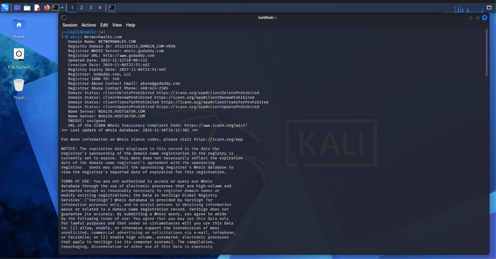
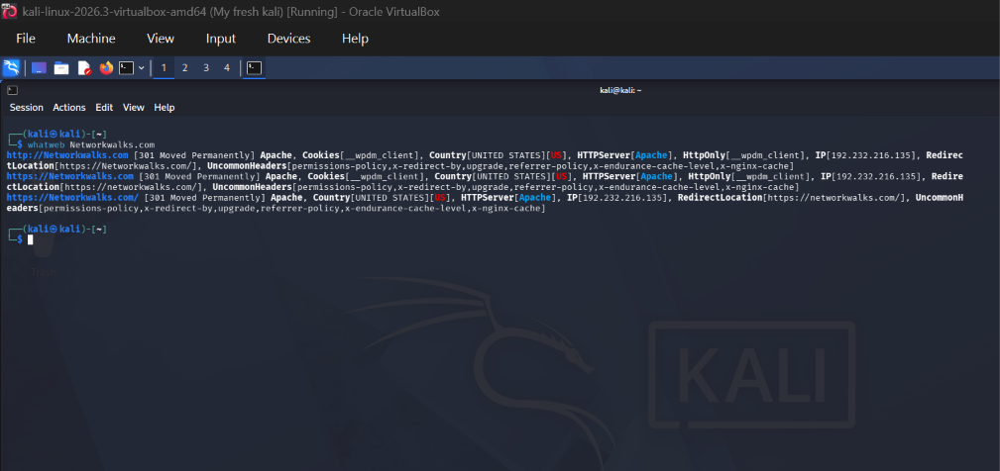
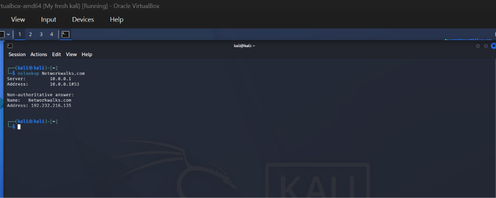
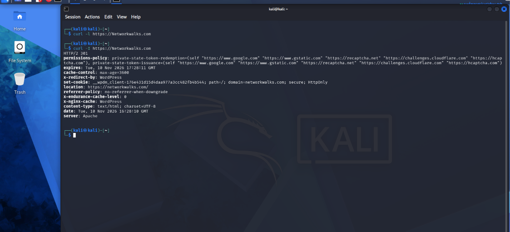
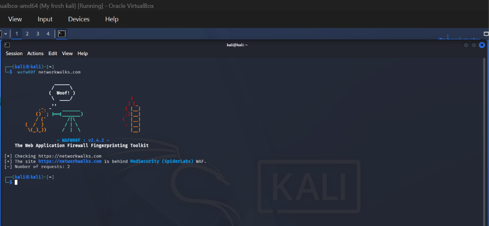
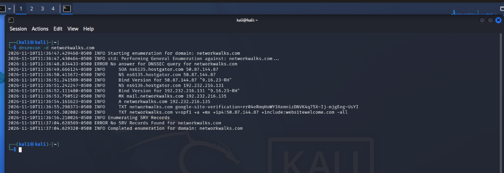
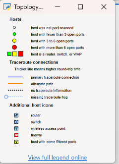

# NETWORKWALKS-B084-WEEK1-CYBERSECURITY-LAB-SETUP
 ## Project Overview (Week 1 | Project Module 1)
This repository contains the documentation and proof of execution for setting up a baseline Cybersecurity testing lab environment. The lab consists of a host machine running VirtualBox and a Kali Linux virtual machine configured for penetration testing tasks.

##  Lab Requirements Achieved
- **Hypervisor:** VirtualBox (Latest Version)
- **Attacker Machine:** Kali Linux (Latest Version, VM)
- **Network Configuration:** NATNetwork configured with `10.0.0.0/24` subnet
- **VM Settings:** Bidirectional Clipboard & File drag/drop enabled
- **Shared Folders:** `/downloads` folder successfully shared from the host machine to the VM
- **IP Configuration:** Kali Linux assigned the IP Address `10.0.0.2/24`
- **Connectivity:** Verified that Kali Linux has full Internet access

## 📸 Proof of Concept (Screenshots)

Below are the screenshots verifying the successful configuration of the lab environment:

### 1. Kali Linux virtual machine
[Kali linux](kaliVM.png)

### 2. VirtualBox NAT Network Configuration
[NAT Network](NAT.png)

### 3. Kali Linux IP Address (`10.0.0.2`)
[Kali IP Address](ipconfig.png)

### 4. Internet Access
[Internet Access such as ping](ping.png)

### 4.Snapshot of VM
[snapshot](snapshotVM.png)
-----------------------------------------------------------------------------------------------------------------------------

# Networkwalks Cybersecurity Internship - Week 2 Practical Labs

## 📌 Overview
This repository contains the lab documentation, execution commands, and task summaries for **Week 2** of the **Networkwalks Cybersecurity Internship Program**.

---

## 🛠️ Practical Module 1: Reconnaissance & Information Gathering

### Task 1: Domain Registration Details (`whois`)
* **Command:** `whois networkwalks.com`
* **Description:** Retrieved domain registration details, owner info, registrar data, creation/expiry dates, and authoritative name servers.
* 

### Task 2: Web Technology Fingerprinting (`whatweb`)
* **Command:** `whatweb networkwalks.com`
* **Description:** Identified web application tech stacks, server software, CMS details, embedded scripts, and HTTP status codes.
* 

### Task 3: DNS Resolution (`nslookup`)
* **Command:** `nslookup networkwalks.com`
* **Description:** Queried DNS servers to resolve hostnames to their respective IP address mappings.
* 

### Task 4: HTTP Response Headers Inspection (`curl -I`)
* **Command:** `curl -I https://networkwalks.com`
* **Description:** Inspected HTTP response headers to analyze web server configurations and missing security headers.
* 

### Task 5: Web Application Firewall Detection (`wafw00f`)
* **Command:** `wafw00f networkwalks.com`
* **Description:** Fingerprinted target behavior to detect and identify active Web Application Firewalls (WAF).
* 

### Task 6: DNS Record Enumeration (`dnsrecon`)
* **Command:** `dnsrecon -d networkwalks.com`
* **Description:** Enumerated essential DNS resource records (A, AAAA, MX, NS, TXT, SOA) for attack surface mapping.
* 

---

## 🌐 Practical Module 5: Subnet Discovery & Network Topology (Zenmap)

### Step 1: Local Network Interface Discovery
* **Command:** `ipconfig /all`
* **Description:** Extracted host machine IP address, subnet mask, and default gateway to define target CIDR scope.

### Step 2: Local Subnet Ping Scan
* **Target / Scope:** `192.168.100.0/24` 
* **Scan Type:** `Ping Scan` (Zenmap)
* **Description:** Performed ICMP ping sweep across the local network segment to identify active live hosts.
* 

### Step 3: Network Topology Visualization
* **Tool:** Zenmap Topology View
* **Description:** Generated host topology graph showing active nodes, network hops, and structural connectivity.
* 
  ------------------------------------------------
  ---

## 📑 WK2-PM-FINAL-REPORT: Executive Penetration Testing Report

### Overview
A formal, comprehensive **Penetration Testing Report** has been written for Week 2 practical activities, summarizing findings from both Footprinting (Module 1) and Subnet Discovery (Module 5).

### 📁 Report Contents & Structure:
1. **Executive Metadata & Liability Disclaimer:** Authorized scope parameters and legal guidelines.
2. **Reconnaissance & Footprinting (W2-PM1):** Detailed execution logs of `whois`, `whatweb`, `nslookup`, `curl -I`, `wafw00f`, and `dnsrecon`.
3. **Network Scanning & Topology (W2-PM5):** Subnet discovery via `ipconfig /all`, active host ping sweep, and MAC/IP mapping via Zenmap.
4. **Risk Analysis & Impact Matrix:** Technical vulnerability impact assessment (Low to Medium severity findings).
5. **Remediation & Recommendations:** 9 actionable security recommendations for perimeter defense and internal asset visibility.

---

### 📄 Access Full Report
- **PDF Version:** `[Penetration_Testing_Report_Week_2.pdf](./Penetration_Testing_Report_Week_2.pdf)` *(Upload your PDF to GitHub and verify file path)*
- **Google Docs Live Version:** [View Report on Google Docs](https://docs.google.com/document/d/1b0gY63gHRRA4Q6O72badc02b1n_ao8astYTK0H--d-Q/edit)
- ---------------------------------------------------------------------------------------------------------------------------

# Week 03: Password Cracking & Hash Analysis

**Internship:** Networkwalks Academy — Cybersecurity Internship  
**Focus Areas:** PDF Hash Extraction, Offline Dictionary Attacks (Johnny GUI), Online Hash Auditing, Flag Capture  

---

## Overview

During Week 3 of the cybersecurity internship, I audited and recovered passwords from four encrypted PDF documents (`$pdf$4*4*128*` format) using both a graphical password-cracking suite (**Johnny — John the Ripper GUI**) on Windows and browser-based security utilities (**Networkwalks Tools**):

1. **W3-PM1:** Password Cracking with **John the Ripper (Johnny GUI)**
2. **W3-PM2:** Password Cracking with **Networkwalks (NW) Tools**

---

## Tools & Environment

* **Operating System:** Windows 11
* **Offline Cracking Suite:** Johnny (GUI frontend for John the Ripper)
* **Online Auditing Utility:** Networkwalks (NW) Hashes & Password Cracking Tools
* **Target Files:**
  * `My Locked PDF1.pdf` (W3-PM1)
  * `My Locked PDF2.pdf` (W3-PM1)
  * `My Locked PDF3.pdf` (W3-PM1)
  * `My Locked PDF1 (for NW Tools Lab WK3-PM2).pdf` (W3-PM2)

---

## Task Breakdown & Methodology

### 1. W3-PM1: Password Cracking with Johnny (JTR GUI)

**Objective:** Extract cryptographic hashes from three locked PDF files (`My Locked PDF1.pdf`, `My Locked PDF2.pdf`, and `My Locked PDF3.pdf`), recover their plaintext passwords using Johnny GUI, and unlock each document to capture the embedded flags.

**Workflow Executed:**
1. Extracted password hashes from the three target PDF documents (`hash1.txt`, `hash2.txt`, and `hash3.txt`).
2. Loaded each hash file into **Johnny (John the Ripper GUI)** via **Open password file** and executed **Start new attack**.
3. Achieved `100% (1/1: 1 cracked, 0 left)` across all three targets, recovering `good-luck`, `password1`, and `1qaz2wsx`.
4. Unlocked all three PDFs using the recovered passwords to verify access and retrieve their flags.

**Proof of Execution — Johnny GUI Cracking Results:**
* **`My Locked PDF1.pdf` (`good-luck`):**
  
* **`My Locked PDF2.pdf` (`password1`):**
  
* **`My Locked PDF3.pdf` (`1qaz2wsx`):**
  

**Proof of Execution — Unlocked PDFs & Captured Flags:**
* **Flag 1 (`My Locked PDF1.pdf`):**
  
* **Flag 2 (`My Locked PDF2.pdf`):**
  
* **Flag 3 (`My Locked PDF3.pdf`):**
  

---

### 2. W3-PM2: Password Cracking with Networkwalks (NW) Tools

**Objective:** Recover the password of `My Locked PDF1 (for NW Tools Lab WK3-PM2).pdf` using Networkwalks' dedicated online password/hash cracking utility and cross-verify previous results.

**Workflow Executed:**
1. Opened the **Networkwalks Hashes & Password Cracking Tools** portal and submitted `My Locked PDF1 (for NW Tools Lab WK3-PM2).pdf`.
2. Executed the dictionary audit, which matched and recovered the password **`password1`**.
3. Unlocked `My Locked PDF1 (for NW Tools Lab WK3-PM2).pdf` using `password1` and retrieved the final flag.
4. Cross-checked the three PDFs from W3-PM1 against NW Tools as well, confirming identical password recovery results across both offline and online utilities.

**Proof of Execution — Networkwalks Tools & Captured Flag:**
* **NW Tools Password Recovery (`password1`):**
  
* **Unlocked PDF & Captured Flag (`My Locked PDF1 (for NW Tools Lab WK3-PM2).pdf`):**
  

---

## Summary of Recovered Passwords & Flags

| Task ID | Target PDF File | Tool Used | Recovered Password | Captured Flag | Status |
| :--- | :--- | :--- | :--- | :--- | :--- |
| **W3-PM1** | `My Locked PDF1.pdf` | Johnny (JTR GUI) | `good-luck` | `nw{cybersecurity_flag_captured_2608}` | Verified |
| **W3-PM1** | `My Locked PDF2.pdf` | Johnny (JTR GUI) | `password1` | `nw{networkwalks_persistence_jtr_270521}` | Verified |
| **W3-PM1** | `My Locked PDF3.pdf` | Johnny (JTR GUI) | `1qaz2wsx` | `nw{networkwalks_flag_250821_1}` | Verified |
| **W3-PM2** | `My Locked PDF1 (for NW Tools Lab WK3-PM2).pdf` | Networkwalks Tools | `password1` | `nw{networkwalks_flag1_jtr_270521_1}` | Verified |

---

## Key Security Takeaways

* **Predictable Password Patterns:** Common dictionary words (`password1`, `good-luck`) and keyboard-walk sequences (`1qaz2wsx`) are cracked within seconds once a document's hash is extracted.
* **Defense-in-Depth:** Organizations should enforce strong passphrase policies (14+ random characters) on sensitive PDFs and avoid reusing predictable patterns across internal documents.

